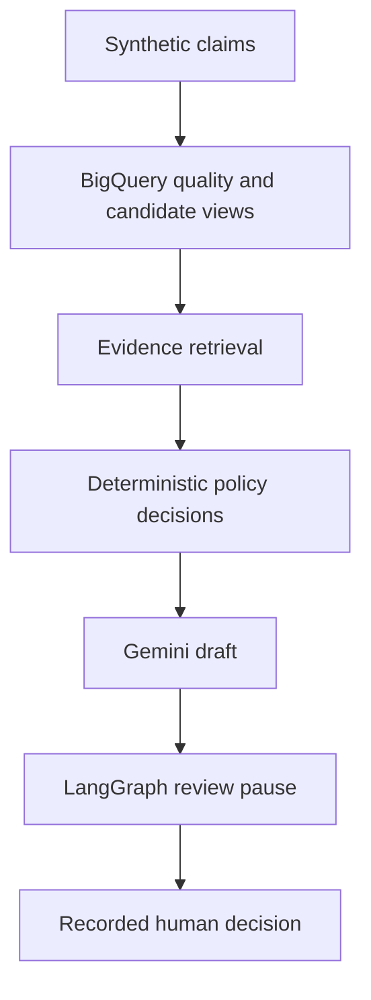

# Compliance Investigation Agent — Team Handoff

Status as of October 11, 2026
**Owner:** Elisha Damor  
**Scope:** Synthetic pharmacy claims portfolio project  
**Platform:** Python, Google BigQuery, Gemini API, LangGraph, SQLite, Git/GitHub
**BigQuery project:** `compliance-agent-509701`  
**Dataset / location:** `compliance_analytics` / `US`

## 1. Executive summary

We built a reproducible synthetic claims pipeline that generates 50,000 transactions, loads them into BigQuery, applies two review rules, collects evidence for flagged claims, and produces a JSON case report with a decision for each applicable policy. Gemini drafts an investigator summary from verified facts; LangGraph orchestrates retrieval, policy evaluation, drafting, and a pause for human review. The current rules are:

- **R001_HIGH_CLAIM_AMOUNT:** high paid claim relative to a pharmacy's routine claim amount.
- **R002_REPEAT_FILL:** a closely repeated paid claim with matching patient, pharmacy, drug, quantity, and amount.

The combined SQL candidate view contains **550 unique flagged transactions**. Against synthetic ground truth, the combined flags find all **400 planted review-positive transactions**, with **150 additional flagged transactions**. The combined flag precision is **72.7%** and recall is **100%** on this generated dataset. These are *candidate detection* metrics, not validated performance of the later Python policy decisions or evidence of fraud.

An `INVESTIGATOR_REVIEW` decision is a deterministic recommendation to examine evidence. The Gemini text is a draft. A local review workflow records an explicit reviewer decision before its status changes; it performs no external escalation or adverse action.

## 2. System flow and ownership



| Stage | Purpose | Implemented artifact |
|---|---|---|
| Generate | Create reproducible synthetic claims and separate ground-truth labels | `scripts/generate_data.py`; `data/generated/ground_truth_v2.csv` |
| Load | Make v2 claims queryable in BigQuery | `scripts/load_transactions_v2.py`; `pharmacy_transactions_v2` |
| Validate quality | Mark missing/invalid evidence before rule use | `v2_claim_quality` |
| Flag R001 | Identify high paid claims | `v2_high_amount_flags` |
| Flag R002 | Identify repeat-fill signals and prior claim references | `v2_repeat_fill_flags` |
| Combine | Produce one candidate row per transaction with `rule_ids` | `v2_case_candidates` |
| Enrich | Add claim and pharmacy baseline evidence and prior claim reference | `v2_case_evidence` |
| Retrieve | Fetch an individual case or complete repeat pair | `scripts/get_case.py`; `scripts/get_repeat_pair.py` |
| Decide | Evaluate R001 and R002 against versioned JSON policies | `scripts/policy_engine.py`; `scripts/evaluate_r002.py` |
| Report | Return evidence plus one decision per applicable policy | `scripts/build_case_report.py` |
| Draft | Summarize selected verified facts for an investigator without changing policy decisions | `scripts/summarize_case.py`; Gemini API |
| Orchestrate | Run evidence retrieval, policy evaluation, and drafting as graph nodes | `scripts/run_case_graph.py`; LangGraph |
| Review | Pause, checkpoint locally, and resume with a recorded human decision | `scripts/review_case_graph.py`; SQLite |
| Measure | Compare candidate IDs against synthetic ground truth | `scripts/evaluate_rules.py` |

The Python project runs locally from `C:\Users\Elish\compliance-investigation-agent` in a virtual environment. BigQuery stores the queryable transaction and view layer; the local repository stores code and policies. The generated rows and ground truth are local artifacts excluded from Git.

## 3. Data and SQL layer

### Dataset versions

The initial prototype used a 500-row synthetic table, `pharmacy_transactions`, and initial quality/evidence views. The current evaluation and reporting path uses the **v2 50,000-row dataset**, `pharmacy_transactions_v2`. Legacy `v_case_evidence` and `scripts/apply_policy.py` refer to the initial prototype; the new unified case report queries `v2_case_evidence`.

### v2 checks and observed volumes

| Measure | Observed result | Interpretation |
|---|---:|---|
| Generated v2 transactions / ground-truth IDs | 50,000 | One label per unique transaction ID; uniqueness is checked by the evaluation script. |
| Quality `PASS` | 49,900 | Claims available to the review rules. |
| Missing prescriber quality exception | 100 | Quality exceptions are separated from normal rule assessment. |
| R001 candidates | 400 | High-amount flags, including 250 planted review positives and 150 planted benign high claims. |
| R002 candidates | 150 | Repeat-fill flags in this dataset. |
| Combined unique candidates | 550 | `v2_case_candidates` returns one case per flagged transaction, with an array of rule IDs. |

The SQL views separate *data quality*, *detection*, and *case evidence*. `v2_case_evidence` includes current claim identifiers and attributes, a pharmacy routine-claim count and average, an amount-to-average ratio, and prior transaction references where relevant. Python retrieves the full prior record through a left join to `v2_claim_quality`; using a left join retains a candidate even when the referenced prior record cannot be retrieved.

**Grain and keys:** The transaction table and local ground truth are intended to have one row per `transaction_id`. The case view has one row per `case_id`, corresponding to the flagged transaction. A case may carry multiple `rule_ids`; therefore, policy decisions are an array rather than one global decision. Retrieval uses a parameterized `@case_id` and rejects zero or multiple case rows.

## 4. Policy logic

### R001 — high claim amount

Policy source: `policies/R001_HIGH_CLAIM_AMOUNT.json`, version `1.0`.

1. The SQL signal identifies a quality-passing, paid claim of at least **$500**.
2. Python checks required evidence: transaction ID, pharmacy ID, claim amount and status, routine-claim count, routine average, and amount-to-average ratio.
3. If required evidence is missing or there are fewer than **10** routine claims, the decision is `NEEDS_MORE_EVIDENCE`.
4. If the claim amount is at least **3 times** the pharmacy routine average, the decision is `INVESTIGATOR_REVIEW`.
5. Otherwise the decision is `MONITOR`.

The combined report checks quality status against the policy and adapts v2's `rule_ids` array to the legacy R001 evaluator's single `rule_id` input. In this particular v2 dataset, no R001 candidate with a ratio below 3 was found, so a real v2 `MONITOR` example has not been demonstrated. R001 still flags 150 synthetic benign high claims; the ratio rule does not distinguish these labels.

### R002 — repeat fill

Policy source: `policies/R002_REPEAT_FILL.json`, version `1.0`.

The Python evaluator retrieves both the flagged current claim and the referenced prior claim. It requires matching **patient ID, pharmacy ID, drug ID, quantity, and claim amount**, paid status and passing quality on both records, and a nonnegative gap of at most **7 days**. Amounts are compared as decimal numbers; dates are compared as dates, and the gap is recalculated from the records rather than trusted from a display field.

| Evidence state | Policy decision |
|---|---|
| Prior required fields are absent | `NEEDS_MORE_EVIDENCE` |
| Prior record conflicts with the signal, statuses/quality do not pass, or interval is outside the window | `MONITOR` |
| Complete matching pair within seven days | `INVESTIGATOR_REVIEW` |

Both JSON policies declare `human_approval_required_for_escalation: true`. A matching pair is a review signal, not proof of an improper fill; legitimate processing or refill activity may explain it.

## 5. Example cases verified end to end

| Case | Evidence | Policy result |
|---|---|---|
| `TXN2-000463` | Paid claim `$692.57`; 442 routine pharmacy claims averaging `$134.20`; amount ratio `5.16`; quality `PASS` | R001 `INVESTIGATOR_REVIEW`; no required evidence missing. |
| `TXN2-000912` | Current paid claim June 22, 2026; prior `TXN2-017575` on June 21; same patient, pharmacy, drug, quantity 35, and amount `$197.99`; both quality `PASS` | R002 `INVESTIGATOR_REVIEW`; one day apart. |

For R002, we also changed a **copy held only in PowerShell memory** to set the prior quantity to 36; the decision became `MONITOR`. Setting the prior record ID to null produced `NEEDS_MORE_EVIDENCE`. Neither exercise changed BigQuery records.

The Gemini and LangGraph draft paths were also run for both example cases. In the checkpointed review path, `TXN2-000912` paused and was returned for revision by Elisha with a note; `TXN2-000463` paused and received an explicit synthetic approval for investigator review. Each decision included a UTC timestamp. These actions changed only local SQLite state, not BigQuery data or any external case system.

## 6. Evaluation method and results

`scripts/evaluate_rules.py --source r001|combined` loads the 50,000-row local `ground_truth_v2.csv`, queries the chosen BigQuery flag/candidate view for transaction IDs, checks for duplicate or unknown IDs, and calculates a confusion matrix. The ground-truth positive label is `expected_review == "1"`.

| Candidate source | TP | FP | FN | TN | Precision | Recall |
|---|---:|---:|---:|---:|---:|---:|
| R001 flags | 250 | 150 | 150 | 49,450 | 62.5% | 62.5% |
| Combined R001 + R002 flags | 400 | 150 | 0 | 49,450 | 72.7% | 100.0% |

Definitions: **TP** is a flagged review-positive transaction; **FP** is flagged but labeled benign; **FN** is review-positive but not flagged; **TN** is neither flagged nor labeled review-positive. Precision is `TP / (TP + FP)`; recall is `TP / (TP + FN)`. The 150 R002 candidates recover the 150 positives missed by R001 in this synthetic dataset. These metrics evaluate the **SQL candidate set**, not investigator outcomes or the accuracy of the policy recommendations.

## 7. Running the current workflow

Run from the repository root in PowerShell with the virtual environment activated. BigQuery calls require Google Application Default Credentials for `compliance-agent-509701`; Gemini calls require a valid `GEMINI_API_KEY` environment variable in the current shell. Never put the API key in a source file, command history, screenshot, or Git commit. The default model is `gemini-3.1-flash-lite`; `GEMINI_MODEL` can override it.

```powershell
# Compare SQL candidates with the local synthetic labels.
python .\scripts\evaluate_rules.py --source r001
python .\scripts\evaluate_rules.py --source combined

# Inspect evidence and deterministic policy decisions.
python .\scripts\build_case_report.py --case-id TXN2-000912

# Create a Gemini draft directly, or via the three-node graph.
python .\scripts\summarize_case.py --case-id TXN2-000912
python .\scripts\run_case_graph.py --case-id TXN2-000912

# Start a checkpointed case and pause for human review.
python .\scripts\review_case_graph.py --case-id TXN2-000912

# Resume a pending case with a human decision and a reason.
python .\scripts\review_case_graph.py --case-id TXN2-000912 --decision RETURN_FOR_REVISION --reviewer Elisha --note "Verify the reason for the repeat claim"

# Run local regression tests.
python -m unittest discover -s tests -v
```

Use a case ID that has not already completed a review in the local checkpoint database when demonstrating the start command. `--case-id` is the flagged **current** transaction ID; the prior ID is evidence attached to that case. The other supported reviewer choice is `APPROVE_ESCALATION`. The graph allows that choice only when a policy returned `INVESTIGATOR_REVIEW` and requires human approval. A reviewer is responsible for the substantive decision; a command-line name is not an authenticated identity.

The review workflow stores checkpoints in `data/generated/review_checkpoints.sqlite`, which is ignored by Git along with the rest of `data/generated/`. It can resume after closing PowerShell on the same machine if the database remains there. It does not synchronize reviewer decisions across machines and does not transmit an escalation to another system. `RETURNED_FOR_REVISION` is a recorded terminal outcome in the current demonstration; there is no automated revision loop.

## 8. Version control and verification status

- The repository is maintained in Git/GitHub. Generated data, ground truth, and the local SQLite checkpoint database are excluded from Git.
- The Gemini summary and LangGraph draft workflow were merged to `main` (observed local merge at `d2a75d2`). The human-review branch commit `a9cf82b` was pushed and its PR was merged; the local `main` fast-forwarded to `437d2f9`.
- R001 `TXN2-000463` and R002 `TXN2-000912` produced deterministic policy decisions and Gemini drafts through both the direct summarizer and LangGraph.
- SQLite review was demonstrated for both policies: R002 returned for revision; R001 approved for escalation as a **synthetic workflow test**. Both records retained reviewer-supplied name, note, and UTC time. No external action was taken.
- `python -m unittest discover -s tests -v` ran **8 passing tests**, covering R001 policy scenarios, R002 boundaries and conflicting evidence, and a guard that prevents a `MONITOR` case from being approved for escalation.
- Candidate precision and recall in section 6 evaluate SQL flags against synthetic labels. They do not measure Gemini factuality, investigator quality, or real-world performance.

## 9. Known limits and next work

1. **Synthetic scope:** All transactions and labels are generated. The results are portfolio demonstrations, not real-world fraud or compliance performance.
2. **Local review record:** SQLite preserves a pause and review outcome on one machine. Reviewer names are self-entered; identity verification, role-based access, centrally managed audit records, and cross-machine persistence remain to be designed before operational use.
3. **No external escalation:** `HUMAN_APPROVED_FOR_ESCALATION` is a local recorded status. There is no ticket, notification, payment action, or external system integration. `RETURNED_FOR_REVISION` has no revision loop yet.
4. **Draft validation:** Pydantic validates the Gemini output shape, and the script checks that cited `evidence_fields` exist in supplied facts. It does not fully verify every narrative claim or question; a human must review the text. The model must never override the deterministic policy decision.
5. **R001 candidate false positives:** All 150 planted benign high claims are flagged by R001. Any threshold change requires evaluating both precision and missed positives against the synthetic labels.
6. **Consistency and traceability:** Standardize R001/R002 reason codes and missing-evidence fields. Capture data snapshot, SQL/view version, policy version, model ID, prompt version, and reviewer identity in a durable case record.
7. **Deployment and reporting:** Review the SQL definitions and generator/load parameters in Git; add repeatable setup, further tests for checkpoint recovery and reviewer controls, an investigator-facing UI or Power BI reporting layer, and container packaging. These are not yet demonstrated.

## 10. Glossary

| Term | Meaning in this project |
|---|---|
| Flag / candidate | SQL rule signal that a transaction should be considered for review. |
| Case ID | Current flagged transaction ID used to retrieve one case. |
| Prior record | Earlier claim referenced by an R002 signal and retrieved for verification. |
| Evidence | Current claim, relevant pharmacy baseline, and any prior claim fields. |
| Policy decision | Deterministic Python result from a versioned JSON policy and case evidence. |
| Ground truth | Synthetic label from the generator used to measure SQL candidate detection. |
| Draft summary | Gemini-written text based on selected verified facts; subject to human review. |
| Checkpoint | Locally stored LangGraph state that lets a paused case resume later. |
| Investigator review | Human assessment of a flagged case; no finding of misconduct is implied. |
| Escalation approval | Recorded reviewer choice for a policy-eligible case; no external action is performed. |
